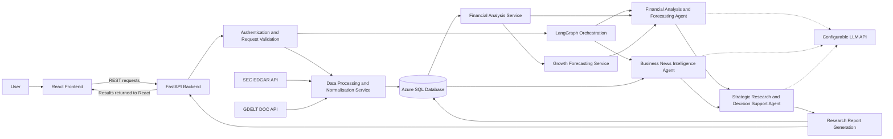
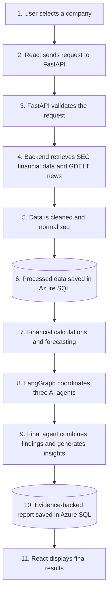
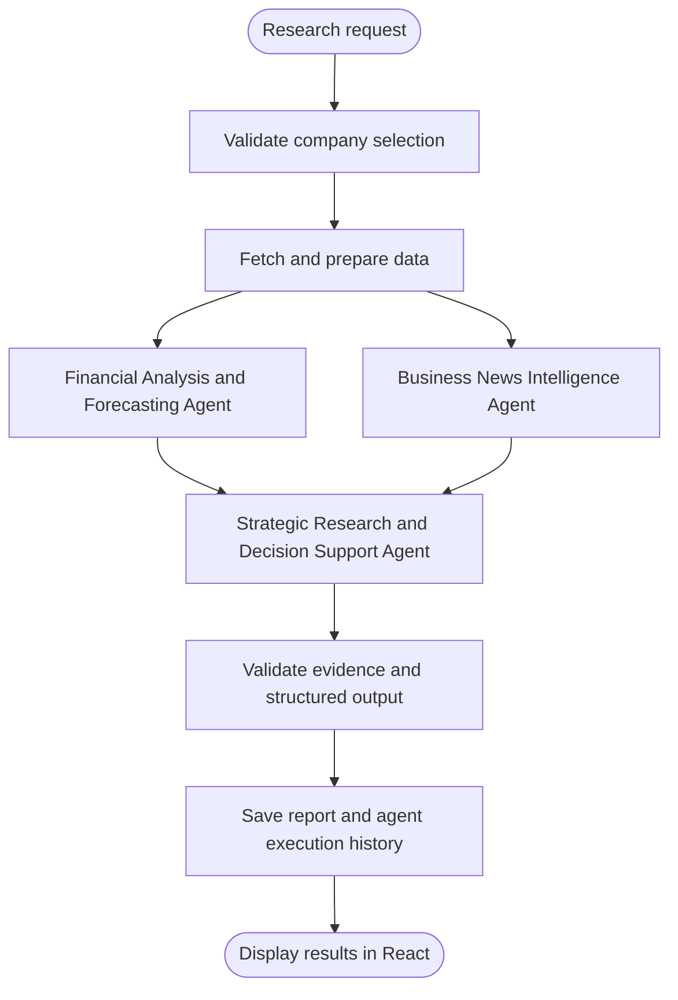
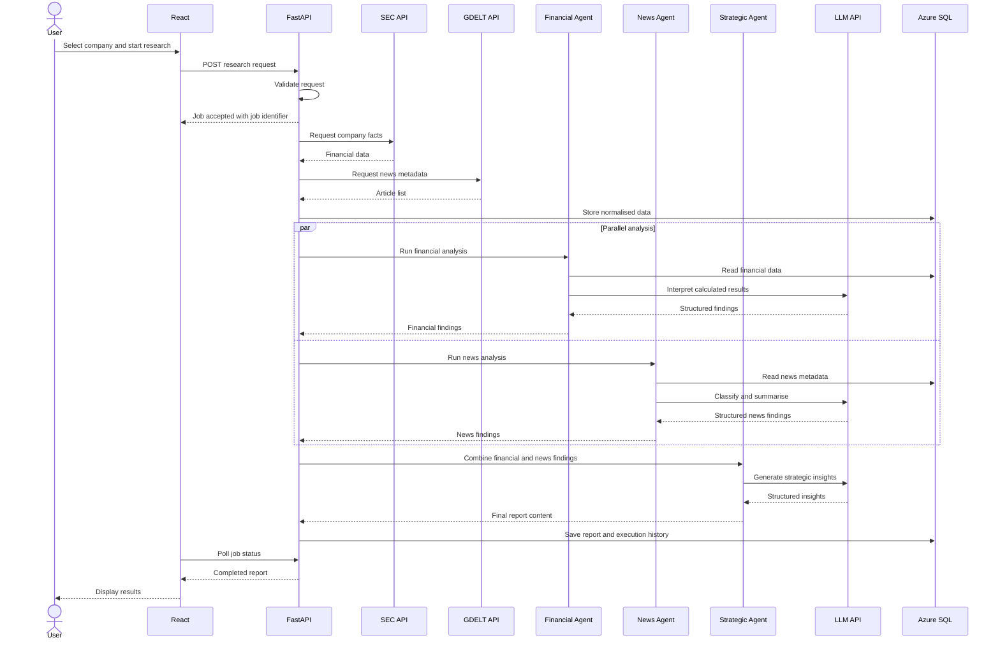

# Architecture

## 1. Component Architecture

## 2. Data Flow

## 3. LangGraph Agent Workflow

## 4. Sequence Diagram

## 5. Component Descriptions

| Component | Responsibility | Input | Output | Communication |
|---|---|---|---|---|
| React frontend | User interface and visualisation | User actions, API responses | Requests, charts, reports | REST calls to FastAPI |
| FastAPI backend | API layer, job management | HTTP requests | JSON responses, job status | Frontend, services, database |
| Authentication and validation | Access control and input validation | Credentials, request bodies | Authorised, validated requests | Inside FastAPI |
| SEC EDGAR service | Retrieval of financial data | Company CIK | Raw XBRL facts, filing metadata | Called by backend |
| GDELT service | Retrieval of news metadata | Company query | Article metadata and URLs | Called by backend |
| Data processing service | Cleaning and normalisation | Raw API data | Normalised records | Writes to Azure SQL |
| Financial analysis service | Deterministic metrics | Stored financial records | Growth rates, margins, ratios | Used by financial agent |
| Forecasting service | Baseline and Statsmodels forecasts | Revenue history | Forecasts, intervals, evaluation metrics | Used by financial agent |
| LangGraph orchestration | Workflow control and shared state | Validated request | Agent outputs | Runs the three agents |
| Financial agent | Interpretation of calculated results | Metrics, forecasts | Structured financial findings | Strategic agent, LLM API |
| News agent | News classification and summarisation | News metadata | Categorised news, developments | Strategic agent, LLM API |
| Strategic agent | Synthesis and report content | Outputs of both agents | Insights, risks, opportunities | LLM API, report service |
| LLM API | Language interpretation | Structured prompts | Structured responses | Called by agents |
| Report generation | Assembling the evidence-referenced report | Strategic output | Stored report, PDF | Azure SQL, FastAPI |
| Azure SQL Database | Persistent storage | Records, reports, logs | Stored and queried data | Backend repositories |

## 6. End-to-End Request Flow

A user selects one to three companies and starts a research request in the React interface. FastAPI validates the request and creates a background job. The backend retrieves financial data from SEC EDGAR and news metadata from GDELT, normalises both, and stores them in Azure SQL. Python services then calculate financial metrics and forecasts. LangGraph runs the Financial Analysis and Forecasting Agent and the Business News Intelligence Agent in parallel. The Strategic Research and Decision Support Agent combines both outputs into insights, risks, opportunities and suggested investigation areas. The evidence is validated, the report and execution history are saved, and React displays the result.

No vector database or embeddings are used. The system works with structured financial data and news metadata.
